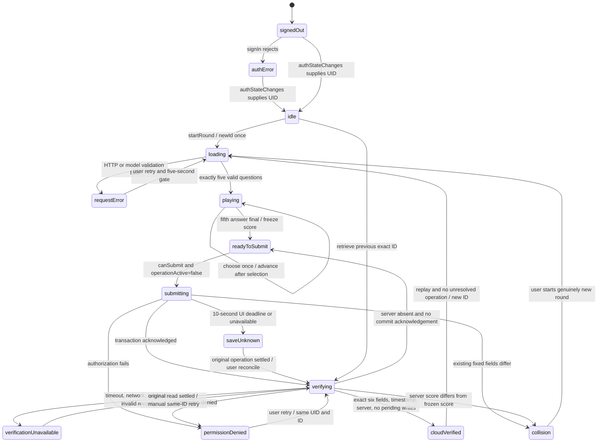
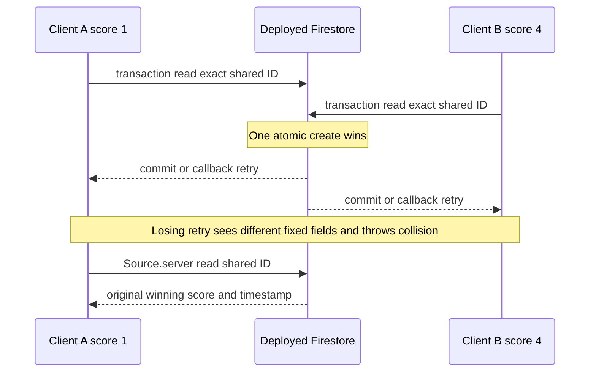

# Implemented round state machine

`identityChanged` increments `_generation` and clears the current round before exposing the new identity. Every completion requires `_current(generation, user, id)`. A stale callback has no transition. Normal sign-out requires `canSignOut`; replay requires `canReplay`. Neither is available while `unresolved` is true. `operationActive` belongs to the original future, not the 10-second waiting future.

# Graduate competing operations

The schedule does not preselect which client wins. G01 records the observed winner. G02 sends separate IDs concurrently and validates each returned UID, document ID and score. G03 delays delivery of a real A server response, changes actual authentication to B, then releases the old response; `_current` rejects it.
